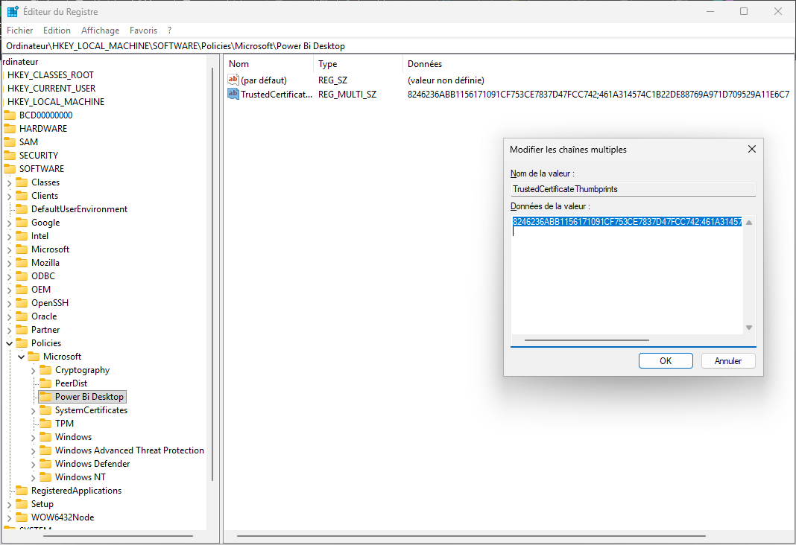
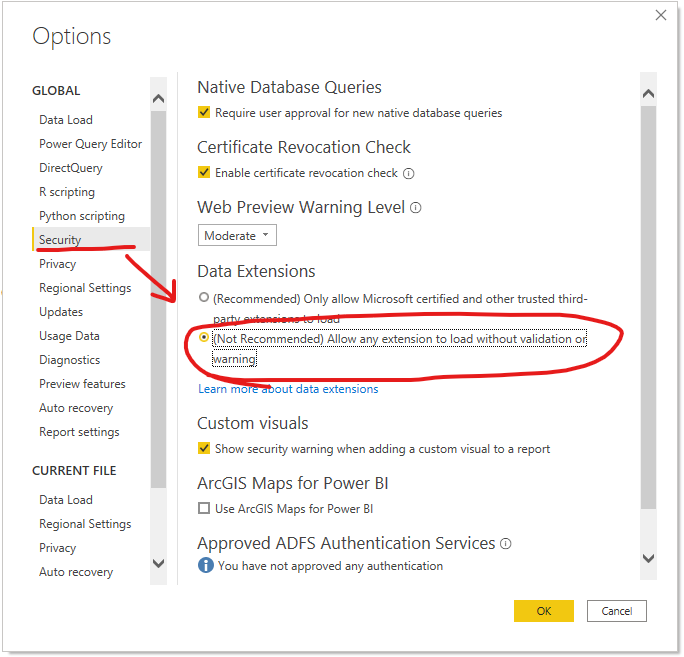
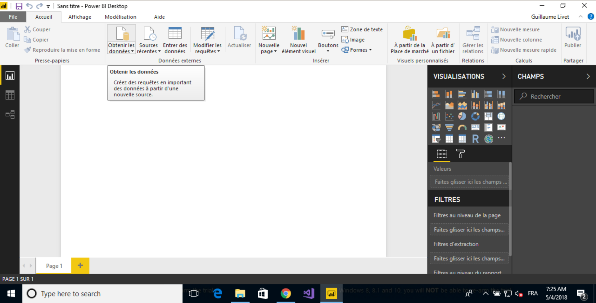
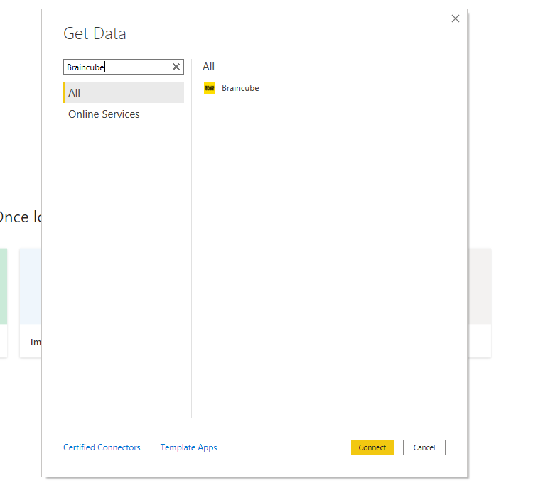
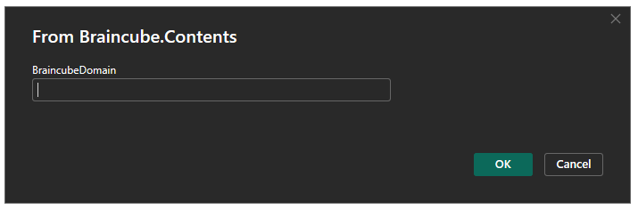
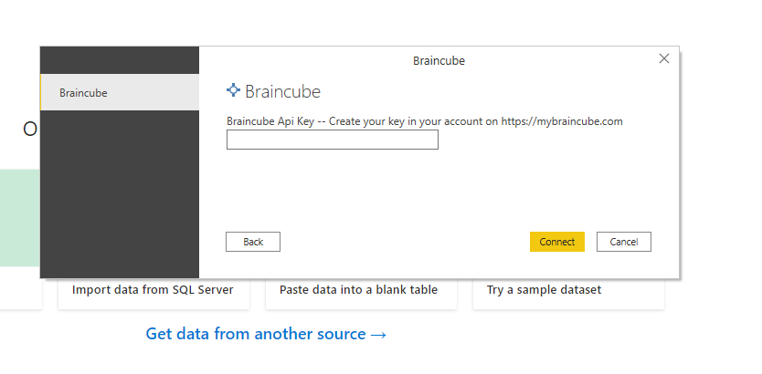
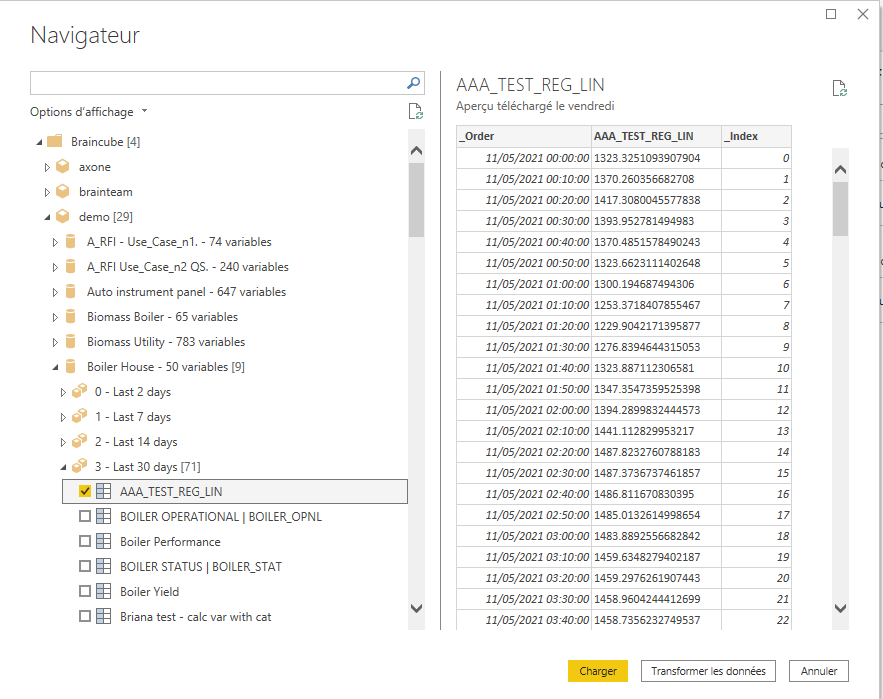
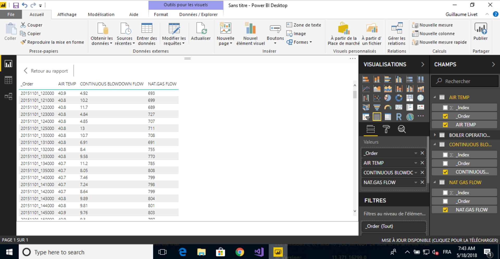
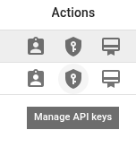
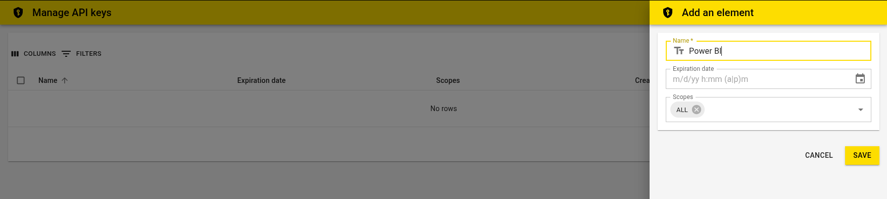

# 
<b>Power BI</b> 

## The software

<a href="https://powerbi.microsoft.com/">Power BI</a> has a desktop application.
It allows you to import data and manipulate, analyze, visualize it. It also proposes a suite of marketing analytics
that provides insights throughout your organization.

## The connector

### Install the connector

There are two ways to install the connector:

#### Option 1: Self-Signed Version (Recommended for security)

1. **Install the trusted certificate**:
   - Download the registry file [TrustedCertificateThumbprints.reg](https://github.com/braincube-io/power-bi-connector/raw/master/TrustedCertificateThumbprints.reg) and double-click to install it.

   - Alternatively, if you prefer not to use registry files, manually add a MultiString value named `TrustedCertificateThumbprints` with the thumbprints `8246236ABB1156171091CF753CE7837D47FCC742;461A314574C1B22DE88769A971D709529A11E6C7` in the Windows Registry at: `HKEY_LOCAL_MACHINE\SOFTWARE\Policies\Microsoft\Power Bi Desktop`

   

2. **Install the connector**:
   - Download the latest self-signed connector (*.pqx) from the [releases page](https://github.com/braincube-io/power-bi-connector/raw/master/releases/)
   - Copy the `.pqx` file to: `%USERHOME%\Documents\Power BI Desktop\Custom Connectors\`
   - Create the folder if it doesn't exist

3. **Restart Power BI Desktop** - The connector should now appear in the "Get Data" dialog

#### Option 2: Unsigned Version (Requires relaxed security settings)

1. **Enable uncertified connectors** in Power BI Desktop:
   - Open Power BI Desktop
   - Go to **File** → **Options and settings** → **Options**
   - Under **Security**, select "Allow loading of custom connectors that haven't been certified by Microsoft"
   - Click **OK** and restart Power BI Desktop

   

2. **Install the connector**:
   - Download the latest unsigned connector (*.mez) from the [releases page](https://github.com/braincube-io/power-bi-connector/raw/master/releases/unsigned/)
   - Copy the `.mez` file to: `%USERHOME%\Documents\Power BI Desktop\Custom Connectors\`
   - Create the folder if it doesn't exist

3. **Restart Power BI Desktop** - The connector should now appear in the "Get Data" dialog

--------

### How to use it?

* **Step 1**

    > Launch the Braincube connector. You will find it in Get Data > Other.
    
    

* **Step 2**

  > You will have to select a domain to connect (see [below](#selecting-braincube-domain))
  

* **Step 3**

  > If you have not yet set up a Braincube connection, you'll have to start one now. You have to have created an API Key from a Service Account (see [below](#creating-an-api-key))
  

* **Step 4**

  > Select the data you want to retrieve (Braincube, Base, Sliding Period, and Variable) and validate
  

You can then use your data in Power BI Desktop as you wish.

-------

# Creating an API Key

The process is simple:

- Go to your [Service Accounts Configuration page](https://cdn.mybraincube.com/account/service-accounts)

- Use one of your existing Service Accounts or create a new one

- Create a new Key

  
  

- The key is created and you get to copy it.

**Be careful, the key will only be displayed once! Copy it somewhere safe**

------
# Selecting Braincube Domain

When connecting to your Braincube instance, you need to specify the correct domain:
- Open your Braincube instance in your web browser
- Look at the URL in the address bar: it should look like `mybraincube.com` or `eu.mybraincube.com`
- Use this domain when prompted by the connector
